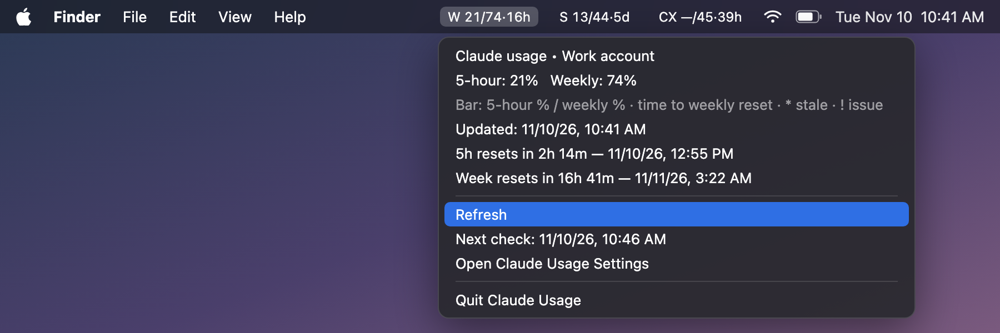
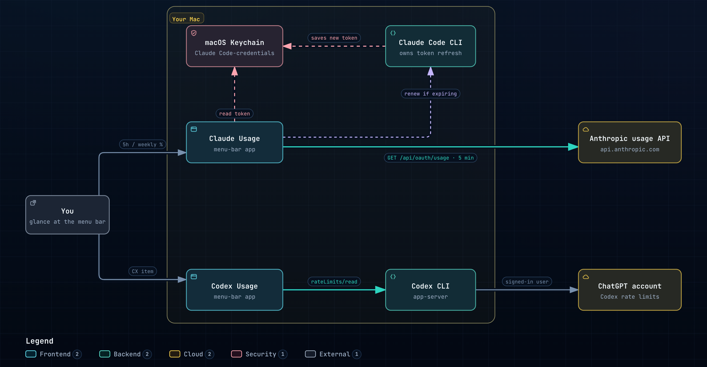

# AI Usage Menu Bar

Two small macOS menu-bar apps that show how much of your Claude and Codex plan limits you have used, so you can pace your work and use the full allowance before it resets.

<p align="center"></p>

<sub>Preview with sample numbers (two Claude accounts, W and S, plus Codex). Regenerate it from <code>docs/menu-bar-preview.html</code>.</sub>

Each item reads **badge, 5-hour % used / weekly % used, time until the weekly reset**. The countdown shows its largest unit: days when 2 or more days remain, then hours, then minutes. `—` means that window is unavailable. A trailing `*` means the number is stale, and `!` means there is a problem. Click an item for the exact percentages, both reset times, and a Refresh button.

- **Claude Usage** follows your **Claude Code** login. It can show up to four accounts, each as its own item.
- **Codex Usage** (`CX`) follows your **Codex CLI** login (ChatGPT account).

Both apps refresh every 5 minutes, run without a Dock icon, and start at login.

Claude Usage also helps you pace yourself:

- **Colors:** the item turns orange when either window passes 80%, and red at 95%.
- **Pace:** the menu compares each window's usage with how much of it has elapsed, for example `Week pace: 4% used, 18% elapsed — 14 pts under pace`. Within 5 points counts as on pace.
- **Alerts:** a macOS notification fires once when a window crosses 80% and again at 95%. The first alert asks for notification permission.
- **Refresh:** fetches right away. It is limited to once every 30 seconds and stays off while the usage API is rate limiting.

## Requirements

- macOS 13 or later, with the Xcode Command Line Tools (`xcode-select --install`).
- For Claude: Claude Code installed and signed in (`claude auth login`).
- For Codex (optional): Codex CLI installed and signed in (`codex login`).

## Install

The easiest way is to open this folder in Claude Code and say *"install the usage menu bar for me"*. [CLAUDE.md](CLAUDE.md) tells it what to do.

To install by hand:

```bash
git clone https://github.com/naimur-mangosteen/ai-usage-menu-bar.git
cd ai-usage-menu-bar
./install.sh            # both apps
./install.sh claude     # only Claude Usage
```

This builds the apps, runs their self-tests, copies them to `~/Applications`, starts them, and turns on Open at Login. If an item is hidden behind the notch, Command-drag menu-bar icons to make room. To update, `git pull` and run `./install.sh` again. To remove, run `./uninstall.sh`.

## Two Claude accounts

By default, Claude Usage shows the account that `claude` is signed in to. To monitor a second account, give it its own Claude Code config directory and sign in there:

```bash
CLAUDE_CONFIG_DIR=~/.claude-second claude auth login
```

Then create `~/Library/Application Support/Claude Usage/accounts.json` (see [examples/accounts.json](examples/accounts.json)):

```json
[
  {"label": "Work account", "badge": "W", "configDir": null},
  {"label": "Second account", "badge": "S", "configDir": "~/.claude-second"}
]
```

`configDir: null` is the default `~/.claude` login. `badge` is the short prefix shown in the menu bar. Quit Claude Usage from its menu and reopen it after editing the file.

Check which account a slot is signed in to with `claude auth status` (add `CLAUDE_CONFIG_DIR=...` for the second slot). The Claude Desktop app has its own login, which can be different from Claude Code's.

## Privacy and how it works



<sub>Made with <a href="https://github.com/tt-a1i/archify">Archify</a>. Source: <code>docs/architecture.archify.json</code>; download <code>docs/architecture.html</code> for the interactive version.</sub>

- **Claude:** reads Claude Code's own Keychain item (`Claude Code-credentials`, or `Claude Code-credentials-<hash>` for another config directory) through `/usr/bin/security`. This is the same tool Claude Code uses to write the item, so macOS does not ask for your Keychain password. The token stays in memory and is only sent to `api.anthropic.com/api/oauth/usage`. When the token is about to expire, the app asks Claude Code to renew it by starting it in initialization-only mode, which sends no prompt and uses no tokens.
- **Codex:** asks the Codex CLI for its rate limits (`codex app-server`). The app never sees Codex credentials.
- Nothing is logged, written to disk, or sent anywhere else. Both apps use undocumented endpoints, so a CLI update could break them. If that happens, the item shows `!` and the menu explains why.

## Troubleshooting

| Symptom | Fix |
|---|---|
| `—/—!` with "sign in" in the menu | Run `claude auth login` (or `codex login`), then click Refresh. |
| Both Claude items show the same numbers | Both slots are signed in to the same account. Sign the second slot out and back in with the other account. |
| `CX` keeps failing | Check that `codex` works in Terminal. The app looks for it in `~/.local/bin`, `/opt/homebrew/bin` and `/usr/local/bin`. |
| An item is missing from the menu bar | It is hidden behind the notch or by a menu-bar manager. Quit other menu-bar apps or Command-drag to rearrange. |
